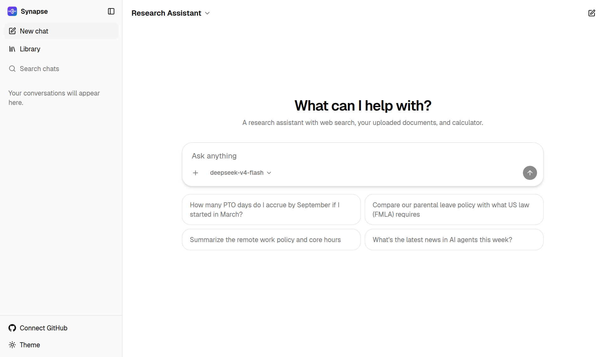
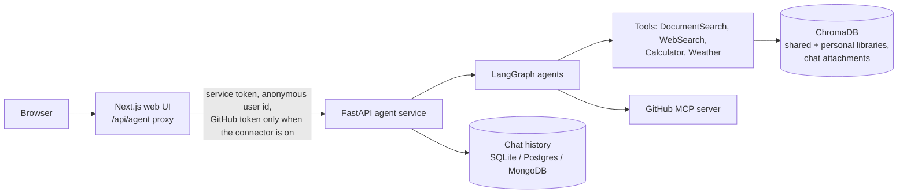

<div align="center">


# Synapse

**A self-hosted, open-source ChatGPT alternative that answers from your documents, the web and your
GitHub repositories.**

Built on [LangGraph](https://langchain-ai.github.io/langgraph/) agents, a [FastAPI](https://fastapi.tiangolo.com/)
service and a [Next.js](https://nextjs.org/) web UI. Works with DeepSeek, OpenAI, Anthropic, Google,
Ollama and other model providers.


[](LICENSE)

[Quickstart](#quickstart) · [Features](#features) · [How it works](#how-it-works) ·
[Configuration](#configuration) · [API](#api-and-python-client)

</div>



## What is Synapse?

Synapse is an AI assistant you run on your own machine or server. You chat with it like ChatGPT, but
it can also look things up: it searches documents you upload (retrieval-augmented generation, or RAG),
searches the web, does exact calculations, checks the weather, and reads or changes your GitHub
repositories through the Model Context Protocol (MCP). It decides which tools a question needs,
shows each step as it works, and cites the pages it used.

Everything runs under your control: your documents are indexed into a local ChromaDB, chats are
stored in SQLite, Postgres or MongoDB, and API keys and GitHub tokens never reach the browser. You
choose the model, from hosted APIs to local models served by Ollama, vLLM or SGLang.

### What you can use it for

- **Ask questions about your own files**: policies, handbooks, contracts, research papers or
  manuals (PDF, Word, Markdown, text), with answers that cite the pages they came from.
- **Research with live data**: combine web search, your documents and a calculator in one answer.
- **Work with GitHub in plain language**: "What changed in owner/repo this week?", "Summarize the
  open issues labeled bug", or, if you allow it, open issues and pull requests.
- **Build your own agents**: add a LangGraph agent in Python and it gets a streaming API, chat
  history and a place in the web UI automatically.

## Features

- **ChatGPT-style web UI**: streaming answers, Markdown and code blocks, page citations, tool steps
  you can expand, stop and retry, light and dark themes, and a mobile layout.
- **Research assistant**: picks the right tools on its own and combines them in one answer:
  document search, web search, calculator, weather, and GitHub when connected.
- **Your library**: each user's own documents (PDF, Word, text, Markdown), private to them and
  searchable from all their chats. A shared library you manage from the `data/` folder is searchable by
  everyone but can't be changed from the web UI.
- **Chat attachments**: files attached to one conversation are searchable only there, alongside the
  library, and are shown on the message they were sent with.
- **Connectors (MCP)**: **+ → Connectors → GitHub** adds GitHub tools to a chat. Each user connects
  their own account with OAuth. Access is read-only unless they turn on **Allow changes**.
- **Chat history**: past conversations grouped by date, with search. Deleting a chat also removes
  the files attached to it.
- **Optional Google sign-in**: run it open (each browser gets an anonymous identity) or require a
  Google account, with admins, open, invite-only or closed sign-ups, free and unlimited plans, an
  admin page, and users' own API keys ([setup](docs/Google_Sign_In.md)).
  Secrets and GitHub tokens never reach the browser, and tokens are never written to the chat database.
- **Agent service API**: streaming and non-streaming endpoints, chat history, a Python client, an
  [AG-UI](docs/AGUI.md) endpoint, and a legacy Streamlit app.
- **Many model providers**: DeepSeek, OpenAI, Anthropic, Google, Groq, AWS Bedrock, Ollama,
  OpenRouter and OpenAI-compatible servers.

## Quickstart

You need [uv](https://docs.astral.sh/uv/getting-started/installation/) and Node.js 20.9 or newer.

```sh
git clone https://github.com/qwertyz15/agent-service-toolkit.git
cd agent-service-toolkit
cp .env.example .env    # then add at least one model API key (see Configuration)

./run.sh                # service on :8080, web UI on http://localhost:3000
```

`run.sh` installs the dependencies on first run, starts the agent service and the web UI together,
and stops both on Ctrl+C or if either one exits.

| Option | What it does |
|---|---|
| `./run.sh --ingest` | Index the files in `data/` into the shared library before starting |
| `./run.sh --streamlit` | Also start the legacy Streamlit app on port 8501 |
| `PORT=8090 WEB_PORT=3001 ./run.sh` | Use different ports |

To try the UI without spending API credits, set `USE_FAKE_MODEL=true` in `.env`.

## Using the app

| To… | Do this |
|---|---|
| Ask anything | Type in the message box. Tool steps such as "Searched documents ✓" appear as the assistant works; click one to see its input and output. |
| Use a file in one chat | **+ → Attach to this chat**. It appears on your next message and stays searchable for the whole conversation. |
| Use a file in all your chats | **+ → Add to my library**, or open **Library** in the sidebar. Only you can see it. |
| Share a file with everyone | Put it in `data/` and run `./run.sh --ingest` (or `scripts/ingest.py`). |
| Work with GitHub | **+ → Connectors → GitHub** (connect first if asked), then ask e.g. "List the recent commits in owner/repo". |
| Let it change things on GitHub | Sidebar **@username → Allow changes**. Without it, every GitHub call is read-only. |
| Delete a chat | Hover over it in the sidebar, then **⋯ → Delete**. Its attached files are removed too. |
| Switch assistant or model | The assistant menu is at the top left; the model menu is in the message box. |

## Configuration

Settings live in `.env`; [`.env.example`](.env.example) lists all of them. The ones you're most
likely to set:

| Setting | Needed for |
|---|---|
| `DEEPSEEK_API_KEY`, `OPENAI_API_KEY`, `ANTHROPIC_API_KEY`, … | At least one model provider |
| `DEFAULT_MODEL` | The model new chats use, e.g. `deepseek-v4-flash` |
| `EMBEDDING_PROVIDER`, `EMBEDDING_MODEL`, `VOYAGE_API_KEY` | Document search: `openai` (uses `OPENAI_API_KEY`) or `voyage` |
| `GITHUB_CLIENT_ID`, `GITHUB_CLIENT_SECRET`, `GITHUB_APP_SLUG`, `WEB_SESSION_SECRET` | Connect GitHub; see [GitHub setup](docs/GitHub_MCP_Agent.md) |
| `AUTH_ENABLED`, `GOOGLE_CLIENT_ID`, `GOOGLE_CLIENT_SECRET`, `ADMIN_EMAILS`, `SIGNUPS`, `ALLOWED_EMAILS` | Google sign-in, admins and who may join; see [Google sign-in](docs/Google_Sign_In.md) |
| `USER_KEYS_SECRET` | Lets signed-in users save their own OpenAI, Anthropic, DeepSeek, Gemini, Groq or OpenRouter key; see [Your own API keys](docs/Google_Sign_In.md#your-own-api-keys) |
| `DEFAULT_PLAN`, `FREE_MESSAGES_PER_DAY`, `FREE_MODELS`, `FREE_MAX_FILE_MB`, `FREE_LIBRARY_FILES` | Plans for signed-in accounts and the free tier's limits; see [Plans](docs/Google_Sign_In.md#plans) |
| `AUTH_SECRET` | Bearer token for the agent service API; required whenever it listens beyond localhost, including Docker |
| `RATE_LIMIT_CHATS_PER_HOUR`, `RATE_LIMIT_CHATS_PER_MINUTE_GLOBAL`, `RATE_LIMIT_UPLOADS_PER_HOUR` | Web UI usage limits per user (IPs get 3x); defaults 60, 120 and 20, `0` turns one off |
| `OPENWEATHERMAP_API_KEY` | The weather tool |
| `GROQ_API_KEY` | Content moderation (LlamaGuard safeguard) |
| `DATABASE_TYPE` | Chat storage: `sqlite` (default, `checkpoints.db`), `postgres` or `mongo` |
| `APP_DATABASE_URL` | The app's own tables (chats, attachments, library indexes); defaults to `sqlite:///app.db`, or Postgres when `DATABASE_TYPE=postgres` |

Provider-specific guides: [Ollama](docs/Ollama.md) ·
[local GPUs with vLLM / SGLang](docs/Local_GPU_Deployment.md) · [Vertex AI](docs/VertexAI.md) ·
[RAG and ChromaDB](docs/RAG_Assistant.md) · [file-based credentials](docs/File_Based_Credentials.md).

## How it works



- **The browser only talks to the web UI.** The web UI's server-side proxy adds the service token
  and the browser's anonymous user ID, so the agent service needs no CORS and secrets stay off the
  browser.
- **GitHub tokens** are kept in an encrypted, httpOnly cookie. They're sent to the service only for
  chats with the GitHub connector on, and passed to the GitHub tools as run context, which is never
  saved with the conversation.
- **Documents** are parsed (pypdf, docx2txt), cleaned, split into ~2,000-character chunks and
  embedded into ChromaDB. The shared library lives in the `rag_documents` collection, each user's
  own library in `user_library` (tagged with the user), and chat attachments in `chat_attachments`
  (tagged with their chat and user). A search returns the best-matching
  passages, never whole files.
- **Conversation memory**: every message, tool call and tool result in a chat is saved and sent back
  to the model on each turn.
- **App database**: SQLAlchemy models (`src/db/`) for chats (owner, title, times), chat attachments
  and the library index, with Alembic migrations applied automatically at startup. Chats that existed
  before are imported once on first start.

## Agents

The web UI shows the agents that are useful day to day; the others stay available through the API
and the Streamlit app.

| Agent | In the web UI | What it does |
|---|---|---|
| `research-assistant` (default) | ✅ | Documents, web search, calculator, weather, and GitHub via the connector |
| `rag-assistant` | ✅ | Answers only from your documents |
| `chatbot` | ✅ | Plain chat, no tools |
| `github-mcp-agent` | API only | GitHub-only agent; superseded by the connector |
| `langgraph-supervisor-agent`, `langgraph-supervisor-hierarchy-agent`, `bg-task-agent`, `interrupt-agent`, `command-agent`, `knowledge-base-agent` | API only | LangGraph feature demos (supervisors, background tasks, interrupts, `Command`, Bedrock knowledge base) |

To add your own agent, create it in `src/agents/` (copy `chatbot.py` or `research_assistant.py`) and
register it in `src/agents/agents.py`. It's then served at `/<agent>/invoke` and `/<agent>/stream`
and appears in the web UI's assistant menu.

## Project structure

```text
src/
  agents/        agents, tools and the shared GitHub MCP tools
  service/       FastAPI service: chat, history, threads, library, attachments, AG-UI
  db/            SQLAlchemy models, Alembic migrations and queries for the app database
  ingestion/     document parsing, chunking and ChromaDB indexing
  memory/        SQLite / Postgres / MongoDB checkpointers
  core/          settings, model setup, embeddings
  schema/        API schemas and the model catalog
  client/        Python AgentClient
  streamlit_app.py  legacy Streamlit UI
frontend/        Next.js web UI (see frontend/README.md)
docker/          Dockerfiles for the service, web UI and Streamlit app
tests/           Python tests
scripts/         ingestion, smoke tests and helpers
docs/            guides
run.sh           start everything locally
```

## Docker

```sh
cp .env.example .env    # add API keys, AUTH_SECRET and POSTGRES_PASSWORD (openssl rand -hex 32)
docker compose watch
```

This starts PostgreSQL, the agent service (port 8080), the web UI (<http://localhost:3000>) and the
Streamlit app (<http://localhost:8501>), and rebuilds or syncs them when you change code. The agent
service, Streamlit and PostgreSQL are only reachable from this machine, and Compose won't start
without `AUTH_SECRET` and `POSTGRES_PASSWORD`. In Docker, chats and the app database are always stored in
the PostgreSQL container's volume, whatever `DATABASE_TYPE` says, so they survive rebuilds. After
changing `pyproject.toml`, `uv.lock` or `frontend/package-lock.json`, run `docker compose up --build`.

## API and Python client

The service's OpenAPI docs are at <http://localhost:8080/redoc>. Main endpoints:

| Endpoint | Purpose |
|---|---|
| `POST /{agent}/stream`, `POST /{agent}/invoke` | Chat (streaming or a single reply) |
| `POST /{agent}/history`, `GET /{agent}/threads`, `GET /chats`, `DELETE /{agent}/threads/{thread_id}` | Chat history, list (per agent or all) and delete |
| `GET/POST/DELETE /rag/my-documents` | A user's own library (`user_id` query parameter) |
| `GET/POST/DELETE /rag/documents` | The shared library (API only; the web UI can't change it) |
| `GET/POST/DELETE /rag/attachments` | Files attached to one chat |
| `GET /info` | Available agents and models |
| `POST /agui/{agent}/run` | [AG-UI protocol](docs/AGUI.md) |

```python
from client import AgentClient

client = AgentClient("http://localhost:8080")  # sends AUTH_SECRET from the environment if set
client.invoke("Tell me a brief joke?").pretty_print()
```

See `src/run_client.py` for streaming and async examples.

## Development

```sh
uv sync --frozen && pre-commit install   # Python dependencies and git hooks
uv run pytest                            # Python tests
cd frontend && npm test && npm run lint  # web UI tests and lint
```

- `scripts/smoke_test.sh` checks the optional integrations against real infrastructure in Docker:
  Postgres and MongoDB checkpointers, the AG-UI endpoint, and LangFuse tracing.
- `langgraph dev` opens the agents in [LangGraph Studio](https://langchain-ai.github.io/langgraph/concepts/langgraph_studio/).
- `uv run python scripts/ingest.py` re-indexes `data/` from the command line (`--dry-run`,
  `--full-rebuild`).

## License

Synapse is released under the [MIT License](LICENSE). See [NOTICE](NOTICE) for third-party code it
includes.
